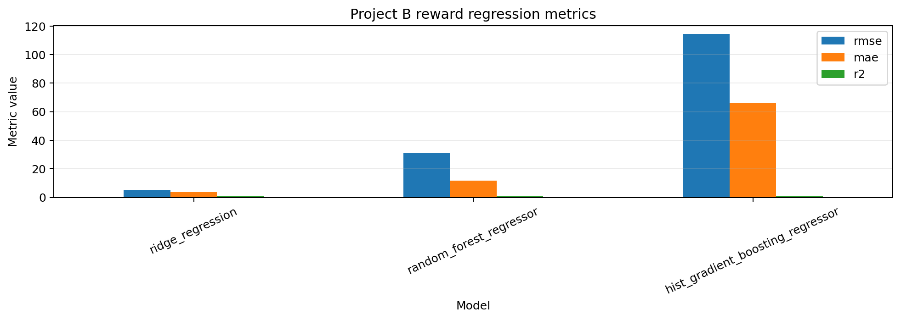
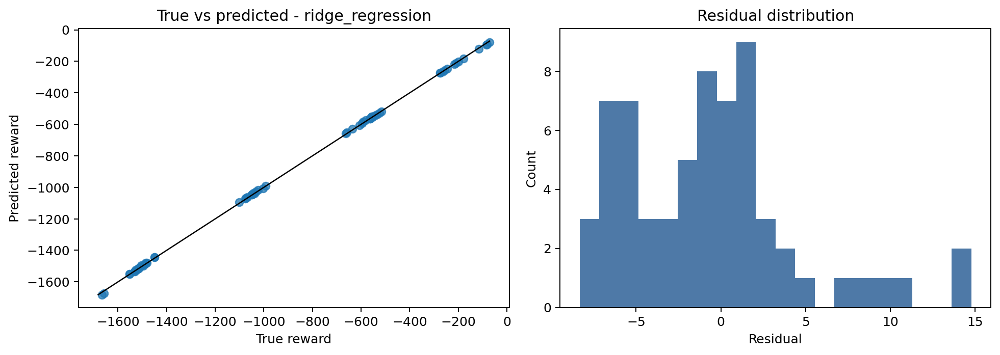
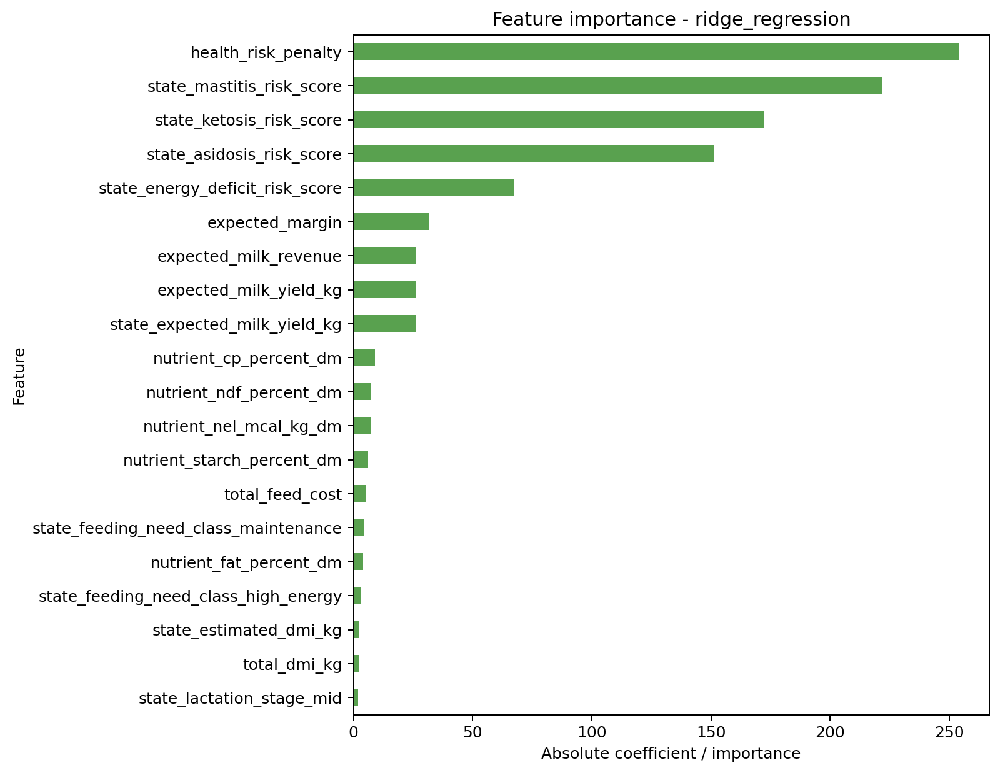

# Project B Rasyon Optimizasyon ve Politika Modeli Notebook Çıktı Dokümantasyonu

Bu doküman, `KDS/Smart_Feed/models/proje_b_rasyon_optimizasyon_politika_modeli/project_b_training_notebook.ipynb` notebook akışının üniversite proje raporunda kullanılabilecek şekilde açıklanmış çıktı özetidir. Notebook dosyasında kaydedilmiş hücre çıktısı bulunmadığı için sonuçlar aynı notebook parametreleriyle yerel PostgreSQL `laktasens` veritabanındaki `ml_smart_feed` şeması üzerinde yeniden çalıştırılarak dokümante edilmiştir.

## 1. Notebook Amacı

Project B notebook'u, Smart Feed karar destek sisteminde rasyon seçimi, beklenen ekonomik getiri, sağlık riski cezası ve aksiyon politikası çıktılarından yararlanarak bir makine öğrenmesi modeli eğitmek için tasarlanmıştır. Bu çalışma, özellikle sentetik/proxy veriyle oluşturulmuş simülasyon tabanlı rasyon adaylarının ödül değerini tahmin etmeyi hedefler.

Notebook varsayılan olarak `reward` hedef değişkenini kullanır. Bu hedef, bir rasyon aksiyonunun beklenen ekonomik marjı ile sağlık riski ve rasyon değişim cezası gibi karar maliyetlerini birlikte temsil eden sayısal bir skordur. Bu nedenle problem varsayılan durumda bir regresyon problemidir.

## 2. Çalıştırma Ortamı ve Bağlantı

Notebook, Python tarafında aşağıdaki temel paketleri kullanır:

| Paket | Kullanım amacı |
|---|---|
| `pandas`, `numpy` | Veri okuma, tablo işleme ve sayısal hesaplama |
| `sqlalchemy`, `psycopg2-binary` | PostgreSQL bağlantısı ve SQL sorgularının DataFrame'e alınması |
| `scikit-learn` | Modelleme, train/test ayrımı, ön işleme ve metrik hesaplama |
| `matplotlib` | Metrik, hata ve özellik önemi grafiklerinin çizimi |
| `joblib` | İstenirse eğitilen modelin dosyaya kaydedilmesi |

Notebook veritabanına `SMART_FEED_DATABASE_URL` ortam değişkeniyle bağlanır. Yerel çalıştırmada bağlantı hedefi `postgresql+psycopg2://postgres@localhost:5432/laktasens` olarak kullanılmıştır.

## 3. Eğitim Parametreleri

Notebook'ta varsayılan deney ayarları aşağıdaki gibidir:

| Parametre | Değer | Açıklama |
|---|---:|---|
| Hedef değişken | `reward` | Rasyon/politika aksiyonunun sayısal ödül skoru |
| Problem tipi | Regresyon | Sürekli değer tahmini yapılır |
| Veri ayrımı | `time` | Eğitim/test ayrımı tarihe göre yapılır |
| Test oranı | `0.25` | Tarihlerin son yüzde 25'lik bölümü test seti kabul edilir |
| Karşılaştırılan modeller | Ridge Regression, Random Forest Regressor, Hist Gradient Boosting Regressor | Üç farklı model ailesi kıyaslanır |
| Model/artifact kaydı | Kapalı | `SAVE_MODEL_AFTER_REVIEW = False` olduğu için dosyaya kayıt yapılmaz |

Varsayılan hedef `reward` olmakla birlikte notebook kodu `total_score`, `total_feed_cost`, `good_ration` ve `reward_band` hedefleri için de yeniden kullanılabilecek biçimde hazırlanmıştır.

## 4. Veri Seti Çıktısı

Notebook veri setini `ml_smart_feed.sim_transition`, `sim_state`, `sim_action`, `opt_ration_candidate` ve `opt_ration_score` tablolarını birleştirerek üretir. JSON alanları açılarak modelin kullanabileceği sayısal ve kategorik özniteliklere dönüştürülür.

### 4.1 Genel Veri Özeti

| Ölçüt | Değer |
|---|---:|
| Toplam satır sayısı | 224 |
| Tekil inek sayısı | 16 |
| İlk kayıt tarihi | 2023-07-21 |
| Son kayıt tarihi | 2023-08-03 |
| Hedef değişken | `reward` |
| Hedef değişkende eksik değer | 0 |

Bu çıktı, modelleme aşamasına giren veri setinde eksik hedef değeri olmadığını ve her kaydın bir rasyon/politika geçişi olarak kullanılabildiğini göstermektedir.

### 4.2 Hedef Değişken Dağılımı

| İstatistik | Değer |
|---|---:|
| Gözlem sayısı | 224 |
| Ortalama `reward` | -977.1424 |
| Standart sapma | 603.5369 |
| Minimum | -3010.5012 |
| 1. çeyrek | -1489.1784 |
| Medyan | -1020.5798 |
| 3. çeyrek | -543.1435 |
| Maksimum | -70.9149 |

`reward` değerlerinin negatif olması, ödül fonksiyonunda risk cezası, rasyon değişim cezası ve maliyet bileşenlerinin güçlü biçimde etkili olduğunu göstermektedir. Daha az negatif değerler daha avantajlı rasyon kararlarını, daha çok negatif değerler ise daha maliyetli veya daha riskli kararları temsil eder.

### 4.3 Örnek Kayıt Yorumu

İlk satırda `cow_id=1` için `2023-07-21` tarihinde bir `ration_choice` aksiyonu yer almaktadır. Bu kayıtta:

| Alan | Değer |
|---|---:|
| `reward` | -188.7002 |
| `total_feed_cost` | 206.705 |
| `expected_milk_yield_kg` | 34.927 |
| `expected_milk_revenue` | 824.0048 |
| `expected_margin` | 617.2998 |
| `health_risk_penalty` | 686.0 |
| `ration_change_penalty` | 120.0 |
| `candidate_rank` | 1 |
| `feasible_flag` | 1 |
| `selected_flag` | 1 |

Bu örnek, rasyon adayının teknik olarak uygulanabilir olduğunu ve seçilmiş aday olarak işaretlendiğini göstermektedir. Beklenen süt geliri ve yem maliyeti pozitif bir marj üretse de sağlık riski ve rasyon değişim cezası toplam ödül skorunu negatife çekmektedir.

## 5. Train/Test Ayrımı

Notebook'ta zaman bazlı ayrım kullanıldığı için daha eski tarihler eğitim setine, en son tarihler test setine ayrılmıştır.

| Set | Satır sayısı | Tarih aralığı |
|---|---:|---|
| Eğitim seti | 160 | 2023-07-21 - 2023-07-30 |
| Test seti | 64 | 2023-07-31 - 2023-08-03 |

Zaman bazlı ayrım, modelin geçmiş kayıtlarla eğitilip daha sonraki tarihlerdeki kararları tahmin etmesi açısından gerçek karar destek senaryosuna daha yakındır. Bu yaklaşım, rastgele ayrımdan farklı olarak zaman sızıntısı riskini azaltır.

## 6. Modelleme Çıktıları

Üç regresyon modeli karşılaştırılmıştır. Değerlendirme metrikleri aşağıdaki gibidir:

| Model | Eğitim satırı | Test satırı | RMSE | MAE | R² |
|---|---:|---:|---:|---:|---:|
| Ridge Regression | 160 | 64 | 5.0335 | 3.8424 | 0.9999 |
| Random Forest Regressor | 160 | 64 | 31.1080 | 11.8666 | 0.9963 |
| Hist Gradient Boosting Regressor | 160 | 64 | 114.6394 | 66.1074 | 0.9494 |

### 6.1 Metriklerin Anlamı

RMSE, tahmin hatalarının kareli ortalamasının kareköküdür ve büyük hataları daha fazla cezalandırır. Bu deneyde en düşük RMSE değeri Ridge Regression modelinde elde edilmiştir.

MAE, tahminlerin gerçek değerden ortalama mutlak sapmasını gösterir. Ridge Regression modelinin MAE değeri yaklaşık 3.84'tür. `reward` değerlerinin yüzlerce ve binlerce ölçeğinde değiştiği düşünüldüğünde bu hata oldukça düşüktür.

R², modelin hedef değişkendeki varyansı ne kadar açıkladığını gösterir. Ridge Regression modelinin R² değeri 0.9999'dur. Bu sonuç, veri üretim sürecinin büyük ölçüde doğrusal ve kural tabanlı olmasıyla uyumludur.

### 6.2 En İyi Model

Notebook'un seçim metriği regresyon görevinde `rmse` olduğu için en iyi model en düşük RMSE değerine sahip modeldir.

| Seçilen model | Seçim nedeni |
|---|---|
| `ridge_regression` | En düşük RMSE ve MAE değerlerini üretmesi |

Ridge Regression modelinin en iyi sonucu vermesi beklenen bir durumdur. Çünkü sentetik/proxy reward üretiminde ekonomik marj, risk cezası ve rasyon değişim cezası gibi bileşenler doğrudan sayısal kurallarla hesaplanmaktadır. Bu yapı doğrusal modele yüksek uyum sağlar.

## 7. En İyi Modelin Hata Analizi

En iyi model olan Ridge Regression için test setindeki artık hata özeti aşağıdaki gibidir:

| Artık hata metriği | Değer |
|---|---:|
| Gözlem sayısı | 64 |
| Ortalama artık hata | -0.6563 |
| Standart sapma | 5.0299 |
| Minimum artık hata | -8.3193 |
| Medyan artık hata | -0.9565 |
| Maksimum artık hata | 14.7655 |

Ortalama artık hatanın sıfıra yakın olması modelin sistematik olarak aşırı yüksek veya aşırı düşük tahmin yapmadığını gösterir. Artık hata aralığının hedef değişken ölçeğine göre düşük kalması, modelin simülasyon tabanlı reward fonksiyonunu yüksek doğrulukla öğrendiğini destekler.

## 8. Özellik Önemi Çıktısı

Ridge Regression modeli için katsayı büyüklüklerine göre en önemli ilk 20 özellik aşağıdaki gibidir:

| Sıra | Özellik | Önem değeri |
|---:|---|---:|
| 1 | `health_risk_penalty` | 254.0338 |
| 2 | `state_mastitis_risk_score` | 221.7766 |
| 3 | `state_ketosis_risk_score` | 172.1916 |
| 4 | `state_asidosis_risk_score` | 151.3638 |
| 5 | `state_energy_deficit_risk_score` | 67.3792 |
| 6 | `expected_margin` | 31.8175 |
| 7 | `expected_milk_revenue` | 26.3878 |
| 8 | `expected_milk_yield_kg` | 26.3878 |
| 9 | `state_expected_milk_yield_kg` | 26.3878 |
| 10 | `nutrient_cp_percent_dm` | 9.0092 |
| 11 | `nutrient_ndf_percent_dm` | 7.4509 |
| 12 | `nutrient_nel_mcal_kg_dm` | 7.4104 |
| 13 | `nutrient_starch_percent_dm` | 6.2305 |
| 14 | `total_feed_cost` | 5.0792 |
| 15 | `state_feeding_need_class_maintenance` | 4.6878 |
| 16 | `nutrient_fat_percent_dm` | 4.1946 |
| 17 | `state_feeding_need_class_high_energy` | 2.9055 |
| 18 | `state_estimated_dmi_kg` | 2.3775 |
| 19 | `total_dmi_kg` | 2.3775 |
| 20 | `state_lactation_stage_mid` | 1.9629 |

Bu çıktı, model kararında sağlık riski bileşenlerinin en baskın etkiler olduğunu göstermektedir. Özellikle mastitis, ketozis, asidoz ve enerji açığı risk skorları reward tahmininde güçlü sinyal üretmektedir. Ekonomik tarafta `expected_margin`, `expected_milk_revenue`, `expected_milk_yield_kg` ve `total_feed_cost` değişkenleri modelin ikinci önemli bileşen grubunu oluşturur.

Bu sonuç, Project B'nin amacına uygundur: model yalnızca maliyeti azaltmaya değil, maliyet-verim-risk dengesini birlikte optimize etmeye çalışmaktadır.

## 9. Grafik Çıktılarının Rapor Yorumu

Notebook grafik hücresinde beş fonksiyon çağrılır:

| Grafik fonksiyonu | Bu deneydeki çıktı | Rapor yorumu |
|---|---|---|
| `plot_metric_bars(result)` | RMSE, MAE ve R² karşılaştırma grafiği | Ridge Regression'ın en düşük hata değerlerine sahip olduğu görsel olarak görülür |
| `plot_best_binary_curves(result)` | Üretilmez | Hedef regresyon olduğu için ROC/PR eğrisi çizilmez |
| `plot_best_confusion_matrix(result)` | Üretilmez | Hedef regresyon olduğu için karmaşıklık matrisi çizilmez |
| `plot_regression_diagnostics(result)` | Gerçek-tahmin saçılımı ve artık hata histogramı | Tahminlerin gerçek değerlere çok yakın konumlandığı ve artık hataların dar dağıldığı görülür |
| `plot_feature_importance(result, top_n=20)` | En önemli 20 özellik grafiği | Sağlık riski cezası ve risk skorları en baskın değişkenlerdir |

Üniversite proje raporunda bu grafikler model karşılaştırması, regresyon başarımı ve model yorumlanabilirliği başlıkları altında kullanılabilir.

### 9.1 Üretilen Görsel Dosyalar

Notebook'un regresyon çıktıları için aşağıdaki PNG görselleri ayrıca üretilmiştir:



Bu grafik, üç modelin RMSE, MAE ve R² metriklerini karşılaştırır. Ridge Regression modelinin hata metriklerinde en düşük değeri ürettiği görülmektedir.



Bu grafik, en iyi modelin gerçek ve tahmin edilen reward değerlerini ve artık hata dağılımını gösterir. Noktaların referans çizgisine yakın olması modelin tahmin başarımının yüksek olduğunu destekler.



Bu grafik, Ridge Regression modelinde mutlak katsayı büyüklüklerine göre en etkili ilk 20 özelliği gösterir. Sağlık riskiyle ilişkili değişkenlerin en üst sıralarda yer alması, karar fonksiyonunun risk odaklı yapısını doğrular.

## 10. Model Kaydı Çıktısı

Notebook'un son hücresinde model çıktılarının kaydedilip kaydedilmeyeceği kontrol edilir:

```python
SAVE_MODEL_AFTER_REVIEW = False
```

Bu ayar nedeniyle çalışma sonunda artifact klasörüne metrik, tahmin veya model dosyası kaydedilmemiştir. Kayıt açılırsa notebook `artifacts/` altında şu dosyaları üretecek şekilde tasarlanmıştır:

| Dosya | İçerik |
|---|---|
| `metrics.csv` | Model bazlı değerlendirme metrikleri |
| `predictions.csv` | Test seti gerçek ve tahmin değerleri |
| `config.json` | Deney parametreleri ve kullanılan özellik listeleri |
| `<best_model_name>.joblib` | En iyi eğitilmiş model pipeline'ı |

Bu projede raporlanacak sonuçlar için model kaydı zorunlu değildir; ancak tekrarlanabilir deney takibi için kayıt seçeneği ileride açılabilir.

## 11. Bulguların Akademik Yorumu

Bu deneyde en başarılı model Ridge Regression olmuştur. Bunun temel nedeni, Project B veri setinin sentetik/proxy kurallar ile oluşturulması ve reward değerinin büyük ölçüde doğrusal ekonomik-risk bileşenlerinden türetilmesidir. Modelin çok yüksek R² değerine ulaşması, gerçek dünya performans garantisi olarak değil, mevcut simülasyon fonksiyonunun öğrenilebilir olduğunu gösteren bir POC sonucu olarak yorumlanmalıdır.

Random Forest ve Hist Gradient Boosting modelleri de yüksek R² değerleri üretmiştir; ancak Ridge Regression'a göre daha yüksek hata vermiştir. Bu durum veri setindeki örüntünün karmaşık doğrusal olmayan yapılardan çok, ölçeklenmiş sayısal bileşenlerin toplamına benzediğini desteklemektedir.

Özellik önemi sonuçları, sistemin yalnızca ekonomik getiriye değil sağlık risklerine de duyarlı olduğunu göstermektedir. `health_risk_penalty` ve hastalık/risk skorlarının en yüksek öneme sahip olması, rasyon optimizasyonunun hayvan sağlığını karar fonksiyonunun merkezine aldığını göstermesi açısından önemlidir.

## 12. Sınırlılıklar

Bu notebook çıktıları POC amaçlı sentetik/proxy verilerden elde edilmiştir. Bu nedenle sonuçlar doğrudan gerçek çiftlik performansı veya klinik karar doğruluğu olarak yorumlanmamalıdır.

Veri seti 224 modelleme satırıyla sınırlıdır ve gerçek saha verileri geldikçe aynı pipeline daha geniş, daha değişken ve daha gerçekçi gözlemlerle yeniden eğitilmelidir.

Train/test ayrımı zaman bazlı yapılmış olsa da tarih aralığı kısa olduğu için modelin uzun dönem genelleme başarımı henüz ölçülmemiştir.

Reward fonksiyonu kural tabanlı oluşturulduğundan model başarısı, gerçek dünyadaki biyolojik ve ekonomik belirsizlikleri tam olarak temsil etmeyebilir.

## 13. Rapor İçin Kısa Sonuç Paragrafı

Project B kapsamında geliştirilen rasyon optimizasyon ve politika modeli, sentetik/proxy Smart Feed veri seti üzerinde reward tahmini yapacak şekilde eğitilmiştir. Zaman bazlı train/test ayrımı sonucunda 160 satır eğitim, 64 satır test verisi kullanılmıştır. Ridge Regression, Random Forest Regressor ve Hist Gradient Boosting Regressor modelleri karşılaştırılmış; en iyi sonuç Ridge Regression modeliyle elde edilmiştir. Ridge Regression modeli test setinde 5.0335 RMSE, 3.8424 MAE ve 0.9999 R² değerine ulaşmıştır. Özellik önemi analizi, model kararlarında sağlık riski cezası, mastitis, ketozis, asidoz ve enerji açığı risk skorlarının en etkili değişkenler olduğunu göstermiştir. Bu bulgular, önerilen karar destek sisteminin rasyon seçiminde yalnızca maliyet veya süt verimini değil, sağlık riski ve sürdürülebilir besleme dengesini de dikkate aldığını göstermektedir.
