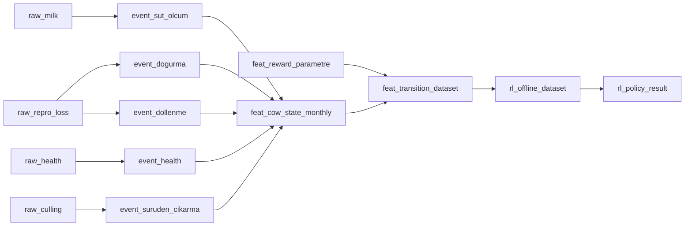

# Dataset Landscape for a Dairy-Cow RL/MDP Prototype in `suru_karar`

## Executive Summary

For a `suru_karar` prototype, the strongest **public** longitudinal backbones I found are **EmbryoLosses** and **Productional data of primiparous dairy cows reared in different social environments during the first 8 weeks after birth**. **EmbryoLosses** is the best open source if you want an actual cow-lactation timeline with **calving date, drying-off or culling, milk production, and health records including reproduction, mastitis, and lameness**. The Valníčková dataset is smaller, but it is unusually valuable for engineering because it explicitly exposes **CowID/CalfID**, daily milk and conductivity, body weight, activity, and an **Events** structure with items such as **Abortion, Birth, Calving, Dry, Entry, Exit, Heat, Change**. citeturn9view0turn44search0turn32view0turn33search0

A very strong third source is the **Marcenat / INRAE productive-functional-longevity dataset**, which includes **dairy performance, BW, BCS, fertility, health events, culling dates and causes, and feeding records**, with downloadable public files and explicit file counts. It is not as obviously test-day rich as the Valníčková data, but it is excellent for **culling causes, health breadth, and reward-side feature engineering**. citeturn39view0

For **milk/test-day** and **reproduction**, the biggest open supporting source is the Argentine SCC dataset with **1,930,376 lactations**, **4,061,230 milk/SCC daily measures**, and **802,066 services**, with service dates, pregnancy diagnosis, calving, and test-day milk/fat/protein/SCC. That makes it the best “volume” source for `raw_milk` and reproduction transition estimation, even though it does **not** expose explicit culling/removal as a first-class variable on the landing page. citeturn3view0turn25search3

For **health/event augmentation**, the best open additions are the **Chiozza-Logroño lameness dataset** and the **subclinical mastitis in USDA organic herds supplemental dataset**. Chiozza gives a clean lameness→milk/repro relationship in one herd across **2010–2017** with **7,156 analyzed lactations** out of **20,086**. The organic mastitis supplement is less transparent on row counts from the landing page, but it is directly relevant because it ties **SCC/subclinical mastitis** to **milk yield, fertility, and culling/survivability during 300 DIM**. citeturn53view0turn22search0turn43search1

For **reward parameters**, the animal-event datasets are not enough by themselves. The cleanest starting package is to combine **USDA NASS all-milk prices**, **USDA AMS cull-cow reports**, **USDA ERS milk-cost-of-production estimates**, and a **replacement-heifer cost source** such as the Iowa State estimate. These give you a workable first-pass reward layer for milk revenue, cull salvage, maintenance/production cost, and replacement cost. citeturn45search0turn45search4turn45search13turn52view0turn50search0

My technical recommendation is **not** to start with direct offline RL as the first modeling layer. The public data landscape is dominated by **observational**, often **single-herd**, mostly **purpose-built epidemiology** datasets, and one of the most RL-like survival/sensor datasets I found is **not publicly downloadable** and reports only **modest discrimination accuracy** across farms. A safer and more realistic first build is: **supervised risk models** for culling, pregnancy loss, mastitis, and lameness; then a **model-based monthly simulator**; and only then a **constrained offline RL layer** for policy testing. citeturn9view0turn53view0turn18view0turn18view3

## Pipeline Fit

In practice, the roadmap that best matches the sources below is: use **EmbryoLosses** or **Valníčková** to define the canonical cow-timeline and event vocabulary, add **SCC grazing cows** for richer milk/reproduction transitions, add **Chiozza** and **organic SCM** for health penalties, then attach **NASS/AMS/ERS/heifer-cost** sources to `feat_reward_parametre`. citeturn9view0turn32view0turn3view0turn53view0turn22search0turn45search0turn45search13turn52view0turn50search0

## Comparison Table

| Priority | Source | Owner / publication / license / format | Scale | Main columns, animal ID, date fields | Coverage | `suru_karar` target and event feed | RL/MDP usability | Key gaps / risks / score | Evidence |
|---|---|---|---|---|---|---|---|---|---|
| A1 | urlEmbryoLossesturn9view0 | Mendeley Data; Universidad Nacional de la Plata + CONICET La Plata; **CC BY 4.0**; downloadable repository files | **25,019 lactation records**, **11,263 cows**; **2010–2018** | Calving date, drying off or culling, milk production, reproduction, mastitis, lameness; animal ID **Y** (cow/lactation-level, exact field name not exposed on landing page); date fields **calving**, **dry-off/cull**, pregnancy-related dates in related paper | Cull **Y** (“drying off or culling”); Milk **Y**; Repro **Y**; Health **Y**; Econ **N** | `raw_milk`, `raw_repro_loss`, `raw_health`, `raw_culling` → `event_dogurma`, `event_dollenme`, `event_sut_olcum`, `event_health`, `event_suruden_cikarma` | **Best public backbone** for state + transition construction; reward still needs external economics | Single large herd; file-level schema not exposed on landing page; likely some paper-specific filtering before analysis. **Score: 5/5** | citeturn9view0turn44search0 |
| A2 | urlProductional data of primiparous dairy cows reared in different social environments during the first 8 weeks after birthturn32view0 | Data in Brief / Mendeley Data; Czech research group; **CC BY**; tables / Mendeley files | Experimental cohort; exact animal count not clearly exposed in the page fragment; daily first-lactation data plus whole-life events | Explicit variables include **CowID**, **CalfID**, survival to first lactation, **Exit age**, first successful insemination, Yield, Conductivity, Milking_Time, Body Weight, Activity; event names include **Abortion, Birth, Calving, Dry, Entry, Exit, Heat, Change**; date fields: event dates + first successful insemination; daily series for first **305 d** of lactation | Cull **Y** (`Exit`, `Exit age`); Milk **Y**; Repro **Y**; Health **Y/limited** (abortion + veterinary/management events); Econ **N** | `raw_milk`, `raw_repro_loss`, `raw_culling`, partial `raw_health` → `event_dogurma`, `event_dollenme`, `event_sut_olcum`, `event_suruden_cikarma`, partial `event_health` | **Excellent schema-shaping dataset** because IDs and event vocabulary are explicit; good for monthly state design | Smaller experimental cohort; first-lactation centric; not ideal alone for robust policy learning. **Score: 4.5/5** | citeturn32view0turn33search0turn38search5 |
| A3 | urlMarcenat productive-functional-longevity datasetturn39view0 | Recherche Data Gouv / INRAE; **Etalab Open License 2.0**; **CSV + TAB + XLSX** | **185 cows**, **1008 observations**, **1999–2010** | Dairy performance, BW, BCS, fertility, health events, culling dates and causes, forage and concentrate intakes, birthdate, age at first calving, age at culling; animal ID likely **Y** (file metadata public, field names not fully listed in open lines); date fields include **birthdate**, **culling dates** | Cull **Y** (date + cause); Milk **Y**; Repro **Y**; Health **Y**; Econ **Y/partial** (feed intake, not prices) | `raw_milk`, `raw_repro_loss`, `raw_health`, `raw_culling`, partial reward features → likely `event_suruden_cikarma`, `event_health`, partial `event_dogurma` / fertility normalization | Very good for culling-cause modeling, feeding covariates, and state enrichment | Likely more lactation/trait oriented than dense daily test-day sequence; smaller than SCC datasets. **Score: 4.5/5** | citeturn39view0 |
| B1 | urlAssociations of somatic cell count with milk yield and reproductive performance in grazing dairy cowsturn3view0 | Mendeley Data; Universidad Nacional de la Plata; **CC BY 4.0**; downloadable repository files | **1,930,376 lactations**, **867 herds**; **4,061,230** milk/SCC daily measures on analysis subset; **802,066 services**; **2000–2014** | Periodic milk yield, fat %, protein %, SCC; service dates, positive pregnancy diagnosis, calving; animal ID **Y** by individual registry logic, but exact field name not shown; date fields **service**, **pregnancy diagnosis**, **calving** | Cull **N/not explicit**; Milk **Y**; Repro **Y**; Health **Y** (SCC/udder-health status); Econ **N** | `raw_milk`, `raw_repro_loss`, `raw_health` → `event_sut_olcum`, `event_dollenme`, `event_dogurma`, `event_health` | **Best open volume source** for milk/test-day and reproduction transitions | No explicit removal/culling field on visible metadata; likely needs pairing with a backbone dataset. **Score: 4/5** | citeturn3view0turn25search3 |
| D1 | urlSupplemental material for subclinical mastitis in certified organic herdsturn22search0 | Mendeley Data linked to JDS paper; **CC BY 4.0**; supplemental files | USDA organic dairy herds; first-month SCM exposure and follow-up through **300 DIM**; row count not visible on landing page | SCC linear scores, milk yield, fertility outcome, culling/survivability outcome; animal ID likely **Y**, exact field names not exposed; date windows centered on first month postpartum and 300-DIM follow-up | Cull **Y** (died or culled during 300 DIM); Milk **Y**; Repro **Y**; Health **Y** (SCM/SCC); Econ **N** | `raw_health`, `raw_milk`, `raw_repro_loss`, `raw_culling` → `event_health`, `event_sut_olcum`, partial `event_suruden_cikarma` | Good **penalty model / health augmentation** source | Supplemental-only metadata is sparse from public landing page; not ideal as main backbone. **Score: 3.5/5** | citeturn22search0turn43search1turn43search0 |
| D2 | urlChiozza-LogronoJ Lameness Grazing Dairy Cowsturn53view0 | Mendeley Data; **CC BY 4.0**; downloadable repository files | One commercial herd, Buenos Aires; **20,086** lactations source, **7,156** analyzed; **2010–Jun 2017** | Lameness timing groups (LG0/LG1/LG2), calving, dried off status, MILK150, MILK305, first service and pregnancy hazards; animal ID **Y** implied at cow-lactation level; date fields include **calving**, **dry-off**, and timing relative to service/pregnancy | Cull **N/not explicit**; Milk **Y**; Repro **Y**; Health **Y** (lameness) | `raw_health`, `raw_milk`, `raw_repro_loss` → `event_health`, `event_sut_olcum`, `event_dollenme` | Strong **health-to-fertility transition** support dataset | Single herd; outcome-oriented summary fields rather than full action logs. **Score: 4/5** | citeturn53view0 |
| C1 | urlConnecting the dots—Calving difficulty, age at first calving, and enhanced cow productionturn11view0 | Mendeley Data; **CC BY 4.0**; downloadable repository files | **1,048,574** calving-difficulty observations from **687 U.S. farms**; time span not stated on landing page | CD score, AFC, milk yield, fat, protein, ECM, peak milk, breed, parity, calf sex, calving year/season, culling reasons; animal ID likely **Y**, exact field name not exposed; date fields at least **calving year/season** | Cull **Y** (reason-based); Milk **Y**; Repro **Y** (AFC/calving); Health **Y/partial** (calving difficulty) | `raw_repro_loss`, `raw_milk`, `raw_culling`, partial `raw_health` → `event_dogurma`, partial `event_suruden_cikarma`, milk normalization | Large and useful for repro/culling covariates, especially calving-risk features | Not clearly a dense longitudinal per-cow test-day dataset; exact time granularity unclear. **Score: 3.5/5** | citeturn11view0 |
| A4 | urlJoint Models to Predict Dairy Cow Survival from Sensor Data Recorded during the First Lactationturn17view0 | MDPI / Animals; **data available on request, not public**; article + private farm databases | **6 Holstein farms**; daily first-lactation sensor data; culling derived from last milk registration; time span not publicly enumerated | Daily milk yield, body weight, rumination; first calving, culling/last milk date, age at first calving, season; animal ID **Y**; date fields **first calving**, **culling/last milk registered** | Cull **Y**; Milk **Y**; Repro **partial** (AFC/survival to future lactation, not explicit service logs); Health **N/implicit only**; Econ **N** | conceptual fit to `raw_milk` + `raw_culling` and sensor-state features → `event_sut_olcum`, `event_suruden_cikarma` | Methodologically close to your RL target because it is a survival-from-time-series problem | **Not publicly downloadable**; authors report modest discrimination across farms; use as benchmark/on-request candidate, not first ETL source. **Score: 3.5/5** | citeturn18view0turn18view3 |
| E1 | urlUSDA NASS Milk Prices Received by Month, USturn45search0 | USDA NASS; official public data; downloadable data files | Monthly; **24 major milk-producing states** | All-milk price received by farmers, by month, per state; no animal IDs; date field = **month** | Cull **N**; Milk **N/A**; Repro **N**; Health **N**; Econ **Y** (milk revenue) | `feat_reward_parametre` only | Best first source for reward-side **milk price** | U.S.-specific; monthly, not cow-level. **Score: 5/5 for reward use** | citeturn45search0turn45search4 |
| E2 | urlUSDA AMS National Weekly Direct Cow and Bull Report / negotiated report familyturn45search13 | USDA AMS; official market report; PDF reports | Daily/weekly | Cull-cow and bull price ranges by class (Premium White, Breaker, Boner, Cutter), weight ranges, weighted averages; date field = report date | Cull **N/A as event**, but Econ **Y** (cull salvage value) | `feat_reward_parametre` only | Best public source for **cull value / salvage value** | Market-report format requires parsing and regional normalization. **Score: 5/5 for reward use** | citeturn45search13turn45search1 |
| E3 | urlUSDA ERS Milk Cost of Production Estimatesturn52view0 | USDA ERS; official public data; **CSV/XLSX** | Annual; by **state** and **size of operation** | Milk cost of production estimates; date field = **year**; downloadable by state and size | Econ **Y** (maintenance/production cost proxy) | `feat_reward_parametre` only | Strong official seed source for **cost-of-production side** of reward | Not cow-day level; requires conversion to farm/cow/month assumptions. **Score: 4.5/5 for reward use** | citeturn52view0 |
| E4 | urlIowa State Heifer Raising Costs in 2024turn50search0 | Iowa State Extension; official extension source; PDF | Annual benchmark estimate | Replacement-heifer total and per-day raising cost; report snippet states **$1,943** before some ownership/labor components and **$2.65/day** | Econ **Y** (replacement cost) | `feat_reward_parametre` only | Good starting source for **replacement cost** in reward design | Benchmark, not a universal value; some cost components may need adding depending on accounting convention. **Score: 4/5 for reward use** | citeturn50search0 |

## Recommendations

The two sources I would start with are **urlEmbryoLossesturn9view0** and **urlProductional data of primiparous dairy cows…turn32view0**. EmbryoLosses is the strongest open backbone for a cow-lactation decision process because it explicitly includes **calving date, drying off or culling, and milk/reproduction/health records**. The Valníčková dataset is the best open source for **canonical ETL design** because it exposes explicit IDs and an event vocabulary that almost directly maps into `event_dogurma`, `event_dollenme`, `event_sut_olcum`, and `event_suruden_cikarma`. citeturn9view0turn44search0turn32view0turn33search0

If you want a third source immediately after those two, use **urlMarcenat productive-functional-longevity datasetturn39view0**. It adds **culling dates and causes**, health events, and feeding information, which are especially useful for reward shaping and risk decomposition. citeturn39view0

For support sets, I would attach **urlSCC grazing cowsturn3view0** as the main milk/reproduction volume source, **urlChiozza-Logrono lameness datasetturn53view0** as the first health-event augmentation, and **urlcalving difficulty / AFC / culling datasetturn11view0** as a large repro-risk supplement. If you can negotiate access, keep **urlJoint Models survival dataset/paperturn17view0** on the roadmap as a benchmark because it is one of the few sources built around **time-series-to-survival** prediction. citeturn3view0turn53view0turn11view0turn18view0turn18view3

For reward parameters, start with **urlUSDA NASS milk priceturn45search0**, **urlUSDA AMS cull-cow reportsturn45search13**, **urlUSDA ERS milk cost of productionturn52view0**, and **urlIowa State heifer raising coststurn50search0**. After that, if you want disease-specific penalties rather than coarse generic cost penalties, bring in disease-cost literature such as the global disease-loss analysis, the mastitis direct-cost study, and the lameness bioeconomic model. citeturn45search0turn45search13turn52view0turn50search0turn47search0turn47search2turn47search1

## Technical Evaluation

Direct offline RL is **not impossible**, but it is **not the best first modeling step** for these sources. The reason is structural: the public datasets here are mostly **observational**, often **single-herd**, and usually built to answer a narrow epidemiologic or production question rather than to log a rich sequence of decisions and counterfactual outcomes. EmbryoLosses is a single large herd; Chiozza is a single herd; the organic mastitis supplement is outcome-focused; and the most obviously RL-like survival-from-sensor source is not public and reports only moderate predictive discrimination. citeturn9view0turn53view0turn22search0turn18view0turn18view3

The better path is:

1. build **supervised cow-risk models** for removal/culling, conception, pregnancy loss, milk trajectory, mastitis/SCC burden, and lameness burden;
2. convert those into a **monthly state-transition simulator** at cow level;
3. attach **official economic parameters** to compute reward;
4. only then test **constrained offline RL** policies such as “keep / monitor / inseminate / treat / cull.”

That approach fits the actual evidence quality much better than trying to learn a policy directly from sparse, non-randomized farm outcomes. citeturn3view0turn9view0turn39view0turn52view0

## Open Questions and Limitations

Some repository landing pages do **not** expose full file-level schemas, so for several Mendeley rows I marked the ID field name as **“not exposed on landing page”** even when cow-level records are clearly implied. In the same way, some row counts or exact file formats for supplement-only datasets were not visible without downloading files directly. citeturn22search0turn53view0turn9view0

A few publisher and government pages were protected by 403/reCAPTCHA/anti-bot mechanisms in the browsing environment, so I relied on repository metadata, abstracts, search snippets, and accessible landing pages rather than full file inspection. The highest-confidence recommendations above therefore prioritize sources whose **public metadata were explicit**, whose **licenses were visible**, and whose **scope matched your ETL and RL prototype needs most directly**. citeturn41view0turn42view0turn48view0turn49view0