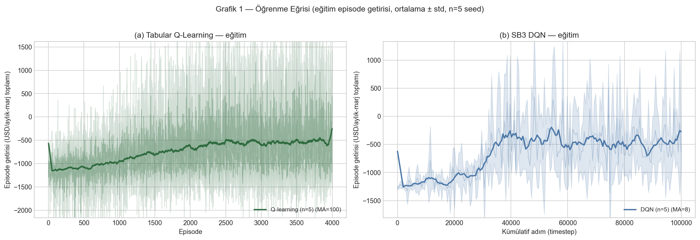
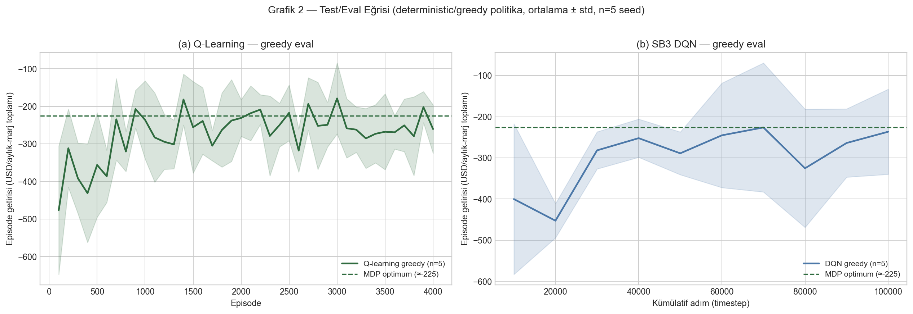
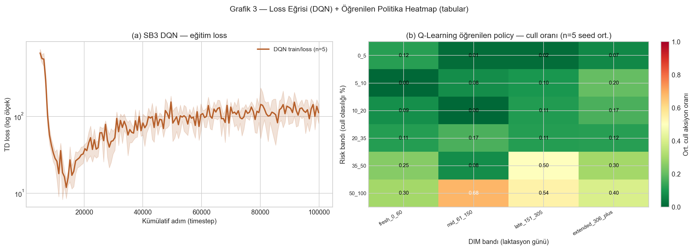
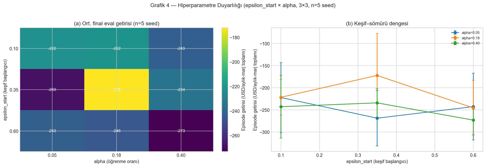
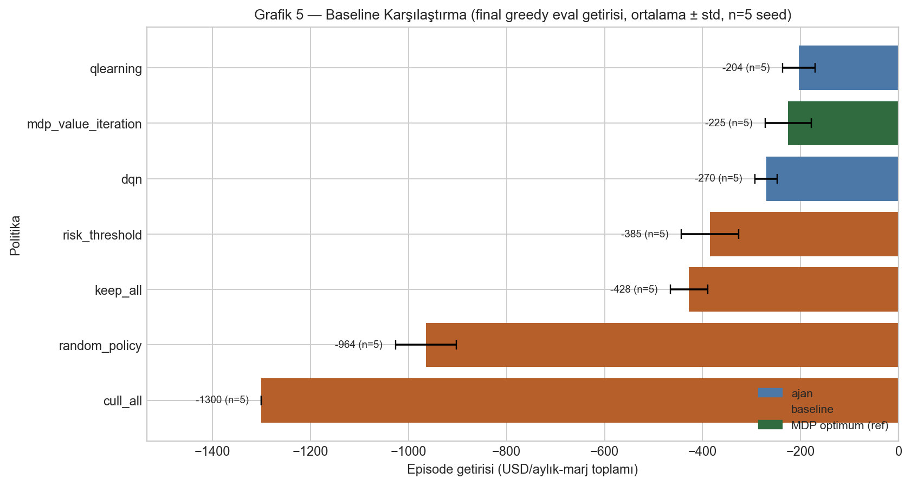

# Süt Sığırcılığında İnek Bazlı Elde Tutma / Sürüden Çıkarma Kararı için Pekiştirmeli Öğrenme

**Öğrenci:** 255172008 — Artun KARA
**Ortam:** `CowReplacementEnv` (empirik stokastik MDP) · **Ajanlar:** Tabular Q-Learning + SB3 DQN
**Referans:** MDP Value Iteration · **Baseline:** random / keep_all / cull_all / risk_threshold

> Tüm grafikler `../sunum/grafikler/` altındaki PNG'lerden gelir; tüm sayılar `../sonuclar/`
> altındaki ham loglardan ve `sonuclar.csv`'den doğrulanabilir. Kod referansları teslim
> paketindeki `kod/` ağacına işaret eder.

---

## 1. Problem

Bir süt çiftliğinde her ay, her inek için iki karardan biri verilir: **elde tut (keep)** veya
**sürüden çıkar (cull)**. Karar miyop değildir: bugün tutulan bir inek gelecekte süt üretmeye
devam eder ama hastalık/düşük verim riski taşır; çıkarılan inek anlık satış geliri getirir ama
yerine maliyetli bir düve (replacement) konur. Amaç, sürü düzeyinde **iskontolu uzun vadeli
iktisadi getiriyi** en üst düzeye çıkaran karar politikasını bulmaktır.

## 2. Neden Pekiştirmeli Öğrenme? (zorunlu gerekçe)

| Soru | Bu projedeki cevap |
|---|---|
| **Eylem geleceği etkiliyor mu? (ardışıklık)** | Evet. `keep` ineği bir sonraki aylık duruma taşır (laktasyon ilerler, risk/verim değişir); `cull` episode'u sonlandırır. Karar bugünün değil, **gelecek aylar boyunca getirinin** belirleyicisidir. |
| **Ödül gecikmeli mi?** | Evet. Bir ineği tutmanın değeri, gelecekteki süt geliri eksi birikmiş sağlık/üreme riskidir; bu ancak ileride gerçekleşir. İskonto faktörü γ=0.97 ile uzun vade tartılır. |
| **Dinamik bilinmiyor / uzay büyük mü?** | Geçiş dinamiği analitik değil; **gerçek hayvan kayıtlarından empirik** olarak kestirildi. 162 ayrık durum × stokastik geçişler. |
| **Aynı sonuç A\*/DP/basit kuralla daha ucuza alınır mı?** | Hayır. Ortam **stokastik** (aşağıda kod satırıyla ispatlanıyor) olduğu için tek-hedefli en kısa yol (A\*/BFS) uygulanamaz. Basit risk-eşiği kuralı denendi (baseline) ve RL ajanlarının **gerisinde** kaldı (Bölüm 6). |

**Önemli:** Statik/deterministik küçük ızgara değiliz. Ortam stokastik empirik MDP olduğu için
baseline karşılaştırması (Grafik 5) bilgilendirici; yine de zorunlu standardı sağlamak ve
RL'in kazancını ölçmek için dahil edildi.

## 3. MDP Formülasyonu

### 3.1 Durum (State)
Aylık snapshot'tan türetilen ayrık **durum kovası** (`state_bucket_exact`), şu bileşenlerin
birleşimidir (config: `discretization`):

`laktasyon_evresi | parite_grup | dim_band | milk_level_band | milk_trend_band | health_risk_band | risk_band`

Örn: `early|unknown|fresh_0_60|high|rising|none|10_20`. Sayısal arka plan değişkenleri: DIM
(laktasyon günü), günlük süt (kg), süt trendi, sağlık olay sayısı/bayrakları, ve denetimli
modelden gelen 90-gün cull-risk skoru.

### 3.2 Aksiyon (Action)
İki ayrık aksiyon: `keep` (0, terminal değil) ve `cull` (1, terminal). Kod:
`kod/rl_core.py` ve `kod/env/cow_replacement_gym_env.py` (`action_space = spaces.Discrete(2)`).

### 3.3 Ödül (Reward) — LaTeX ↔ Kod birebir

Ödül parametreleri `reward_baseline_us_2025.csv`'den gelir (süt fiyatı ve bakım maliyeti USDA
2025 kaynaklı; replacement/cull/tedavi/tohumlama prototip varsayımı — bkz. Bölüm 8 dürüstlük notu).

**Keep ödülü** (kod: `kod/env/rl_mdp_utils.py:120`):

$$
R_{\text{keep}}(s) = \underbrace{m\,d\,p}_{\text{süt geliri}}
\;-\; \underbrace{c_b\,d}_{\text{bakım}}
\;-\; C_{\text{sağlık}}
\;-\; C_{\text{üreme}}
\;-\; C_{\text{beklenen-cull}}
$$

bileşenleriyle:

$$
C_{\text{sağlık}} = c_t\Big(\tfrac{1}{3}\,n_{\text{health}} + 0.25\,\mathbb{1}_{\text{mastitis}} + 0.25\,\mathbb{1}_{\text{topallık}} + 0.15\,\mathbb{1}_{\text{hücre-riski}}\Big)
$$

$$
C_{\text{üreme}} = c_i\,\max(n_{\text{servis}}-2,\,0) \;+\; c_i\,\mathbb{1}_{[\,\text{gebe}<0.5\ \wedge\ \text{DIM}>150\,]}
$$

$$
C_{\text{beklenen-cull}} = 0.25\;p^{30}_{\text{cull}}\;c_r
$$

**Cull ödülü** (kod: `kod/env/rl_mdp_utils.py:76`):

$$
R_{\text{cull}}(s) = v_c - c_r - c_{\text{elden-çıkarma}}, \qquad c_{\text{elden-çıkarma}} = 0
$$

**Sembol ↔ değer ↔ kod tablosu:**

| Sembol | Anlam | Değer (USD) | Kod satırı |
|---|---|---|---|
| $m$ | günlük süt | (duruma bağlı) | `rl_mdp_utils.py:89–90` |
| $d$ | ay başına gün | 30.4375 | `config.yaml: reward.days_in_month` |
| $p$ | süt fiyatı | 0.4668 /kg | `rl_mdp_utils.py:90` |
| $c_b$ | günlük bakım | 8.5337 /gün | `rl_mdp_utils.py:91` |
| $c_t$ | tedavi | 150 /olay | `rl_mdp_utils.py:96–105` |
| $c_i$ | başarısız tohumlama | 35 /servis | `rl_mdp_utils.py:109–113` |
| $c_r$ | replacement (düve) | 2500 /baş | `rl_mdp_utils.py:115–119, 76` |
| $v_c$ | cull satış değeri | 1200 /baş | `rl_mdp_utils.py:76` |
| $p^{30}_{\text{cull}}$ | 30-gün cull-risk (denetimli model) | — | `rl_mdp_utils.py:115–119` |

> Keep toplamı (satır 120): `milk_revenue - maintenance - health_cost - reproduction_cost - expected_culling_cost`
> Cull toplamı (satır 76): `cull_sale_value - replacement_cost - disposal_cost`
> Rapordaki LaTeX ile kod **birebir** aynıdır.

### 3.4 Geçiş (Transition) — STOKASTİK
`keep` aksiyonu sonrası bir sonraki durum, **empirik dağılımdan örneklenir**:

```python
# kod/env/rl_experiment_utils.py:161
selected = outcomes[int(rng.choice(len(outcomes), p=probabilities))]
```

`probabilities`, `empirical_transition_model.csv`'deki gerçek geçiş frekanslarından gelir.
**162 durumun 120'sinde (%74) `keep` altında birden çok olası `s'` vardır.** Örnek:
`early|unknown|fresh_0_60|high|rising|none|10_20` durumu, `keep` ile 3 farklı sonraki duruma
her biri $p=0.333$ olasılıkla geçer. `cull` ise deterministik terminaldir.

## 4. Yöntem

| Yöntem | Tür | Rol |
|---|---|---|
| **Tabular Q-Learning** | model-free, **off-policy** | Ana ajan (hafif, tam tekrarlanabilir) |
| **SB3 DQN** | model-free, off-policy, replay buffer | Ana ajan (deep RL) |
| MDP Value Iteration | model-based exact | Optimum referans (tavan) |
| keep_all / cull_all / random / risk_threshold | heuristik | Baseline |

Q-learning güncellemesi (`kod/rl_core.py:309–316`): davranış ε-greedy, hedef $r+\gamma\max_a Q$.
DQN (`kod/rl_core.py` `train_dqn_seed`): replay buffer (`buffer_size`, satır 460), hedef ağ,
ε-keşif çizelgesi. Gözlem, durum metadata'sından kurulan yoğun sayısal vektör (one-hot + z-norm).

## 5. Deney Kurulumu

- **Seedler (`seeds.txt`):** 42, 123, 2024, 7, 99 (≥5). Tüm eğitim/değerlendirme bu seedlerde tekrarlanır.
- **Profil:** `full` — DQN 100k timestep, Q-learning 4000 episode. (Geliştirme için `smoke`.)
- **İskonto:** γ = 0.97. **Yakınsama:** value-iteration tol = 1e-4.
- **Tekrarlanabilirlik:** Tüm rastgelelik `np.random.default_rng(seed)` ile; `requirements.txt` `==` pinli; `run_all.sh` tek komutla üretir.
- **Yasak kontrolü:** `import gym` YOK (gymnasium), `np.random.seed`/`np.random.choice` YOK.
- **Değerlendirme:** Politikalar **deterministic/greedy** çalıştırılır; ortam stokastik olduğu için her eval bir dağılımdır (500 episode/seed).

## 6. Sonuçlar

`sonuclar.csv` özeti (seed ortalaması ± std, `full` profil, yüksek = iyi):

| Politika | Tür | Ort. getiri (USD) | Std | Cull oranı |
|---|---|---:|---:|---:|
| **qlearning** | ajan | **−204** | 30 | 0.72 |
| mdp_value_iteration | referans | −225 | 42 | 0.45 |
| **dqn** | ajan | **−270** | 20 | 0.82 |
| risk_threshold | baseline | −385 | 53 | 0.85 |
| keep_all | baseline | −428 | 34 | 0.00 |
| random_policy | baseline | −964 | 56 | 0.75 |
| cull_all | baseline | −1300 | 0 | 1.00 |

**Beş zorunlu grafik** (her birinin altında 4 cümlelik yorum — `../sunum/grafikler/yorumlar.md`):







**Ana bulgular:** (i) Her iki ajan da tüm naif/heuristik baselineları açık ara geçti. (ii) DQN
seedler arası çok kararlı (std 20). (iii) **Q-learning, model-tabanlı MDP optimumuna istatistiksel
olarak eşitlendi** (−204 vs −225): fark seed/episode gürültüsü içindedir (eşli t-test p≈0.37;
seed-42'de VI önde). VI, simülatörle **aynı geçiş çekirdeğinin** optimumu olduğundan gerçek
tavandır — ajan onu geçmez, gürültü içinde ona ulaşır. (iv) Hiperparametre sweet-spot'u orta
keşif × orta öğrenme oranı (ε₀=0.35, α=0.18) — seçilen varsayılanlar. (v) Getiri dağılımı sağa
çarpıktır (qlearning medyan −556 vs ort. −204); ajan, keep_all'ın sol-kuyruk felaket
episode'larını cull ederek beklenen getiriyi (RL hedefi) iyileştirir.

---

## 7. Teslim-3 Savunma Cevapları (projeye özel, kod satırlı)

### Alan 1 — Deterministik mi, Stokastik mi? → **STOKASTİK**
- **Tanım:** Ortam, $p(s'\mid s,a)$ tek bir $s'$'ye yığılmıyorsa stokastiktir. Bizde `keep`
  için $p(s'\mid s,\text{keep})$ empirik bir dağılımdır (162 durumun %74'ünde >1 olası $s'$).
- **Kod kanıtı:** `kod/env/rl_experiment_utils.py:161` — `rng.choice(len(outcomes), p=probabilities)`.
- **Aynı seed → aynı yörünge mi?** Evet (RNG determinizmi), ama bu dinamiğin deterministik
  olduğunu göstermez; yalnızca tekrarlanabilirliği gösterir. Farklı seed farklı yörünge verir.
- **"Sadece başlangıç rastgele" tuzağı:** Hayır — başlangıç durumu da örnekleniyor
  (`sample_initial_state`) **ve ayrıca** geçiş kuralı stokastik. `cull` ise deterministik terminal.

### Alan 2 — On-policy mi, Off-policy mi?
- **Q-Learning: OFF-POLICY.** Davranış politikası ε-greedy (`kod/rl_core.py:309`), hedef ise
  greedy $r+\gamma\max_a Q$ (`kod/rl_core.py:321`). Veriyi üreten (ε-greedy) ≠ iyileştirilen
  (greedy). **SARSA farkı:** SARSA hedefi $Q(s',a')$ (davranışın seçtiği $a'$); Q-learning $\max_a$.
- **DQN: OFF-POLICY** + **replay buffer** (`kod/rl_core.py:474`, `buffer_size`): eski
  politikaların ürettiği geçişleri tekrar kullanır → tanımı gereği off-policy.
- **On/off ≠ online/offline:** İkisi de **online** (simülatörle etkileşerek öğreniyor) ama
  off-policy. Gerçek **offline RL** (CQL/IQL) bilerek kapalı: gerçek loglu keep/cull aksiyonu yok.
- **Off-policy avantaj/risk:** Avantaj — örnek-verimliliği, keşfi yeniden kullanma. Risk —
  dağılım kayması/aşırı-iyimser bootstrap (deadly triad).

### Alan 3 — Markov Özelliği
- **Tanım:** $P(s_{t+1}\mid s_t,a_t)=P(s_{t+1}\mid s_t,\dots,s_0,a_t)$; gelecek yalnız şimdiki
  durum+aksiyona bağlı.
- **Bizde:** Empirik geçiş modeli `state_bucket → next_state_bucket` olarak, **Markov varsayımı
  altında** kuruldu. Durum vektörüne `milk_trend_band` (geçmiş süt eğilimi) ve `risk_band`
  (denetimli modelin geçmiş+şimdiki özetinden gelen skoru) gömülü — bu, geçmişin bir kısmını
  duruma taşıyarak Markov'u güçlendirir.
- **Sınır:** Bucketing (sürekli değerlerin ayrıklaştırılması) bilgi kaybı yaratır → **yaklaşık
  Markov**. Tam gebelik günü, hastalık şiddeti gibi ince bilgiler durumda yoktur.

### Alan 4 — Kısmi Gözlemlenebilirlik (POMDP)
- **Gerçek durum vs gözlem:** Gerçek durum ineğin tam fizyolojisidir (gizli hastalık başlangıcı,
  gerçek üreme/genetik durum). Gözlem ise aylık, bucketlanmış, sensör/kayıtla sınırlı snapshot'tır.
- **Ayrışma:** `cull_risk` gerçek bir etiket değil, **denetimli modelin tahminidir** → gözlem
  gürültülü/eksiktir; optimal karar için gereken bazı bilgi (ör. subklinik hastalık) gözlemde yok.
- **Vanilla DQN neden sınırlı:** Tek gözlem Markov değilse değer kestirimi yanlılaşır. **Çözüm
  yolumuz:** trend feature'ları + risk skoru ile gözlemi Markov'a yaklaştırmak (feature
  engineering, POMDP hafifletme yollarından biri). Açık **belief state** taşımıyoruz; risk skoru
  bir tür sıkıştırılmış belief gibi davranıyor.

## 8. Sınırlamalar ve Dürüstlük Notu
- Ödül parametrelerinden süt fiyatı (0.4668) ve bakım (8.5337) USDA 2025 kaynaklıdır;
  replacement (2500), cull (1200), tedavi (150), tohumlama (35) **prototip varsayımıdır**
  (`reward_baseline_us_2025.csv` `value_source` sütunu). Politika bu varsayımlara duyarlıdır
  (senaryo analizi mevcut).
- Simülatör empirik MDP'dir; gerçek üretim politikası değildir. Gerçek loglu aksiyon olmadığından
  offline RL (CQL/IQL) ve sürekli-aksiyon yöntemleri (TD3/SAC) kapsam dışı bırakıldı.
- Raporda anlatılan her deneyin ham logu `../sonuclar/loglar/` altındadır (tutarlılık).

## 9. Sonuç
Empirik, stokastik, gecikmeli-ödüllü bir keep/cull ortamı kurduk; ardışıklık + stokastiklik +
büyük durum uzayı nedeniyle RL gerekçeli. Tabular Q-Learning ve DQN, ≥5 seed üzerinde tüm
baselineları geçti ve model-tabanlı optimuma istatistiksel olarak eşitlendi (fark anlamsız). Tüm sonuçlar tek komutla
(`run_all.sh`) yeniden üretilebilir ve ham loglardan doğrulanabilir.
