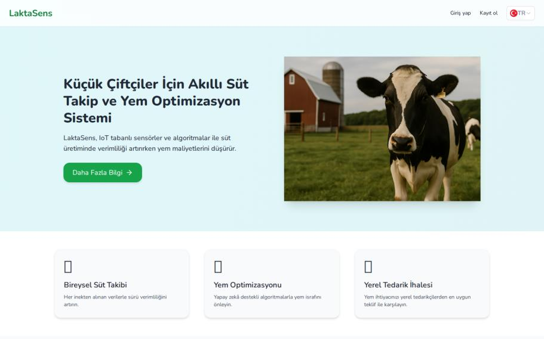
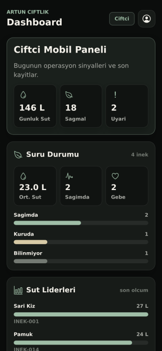
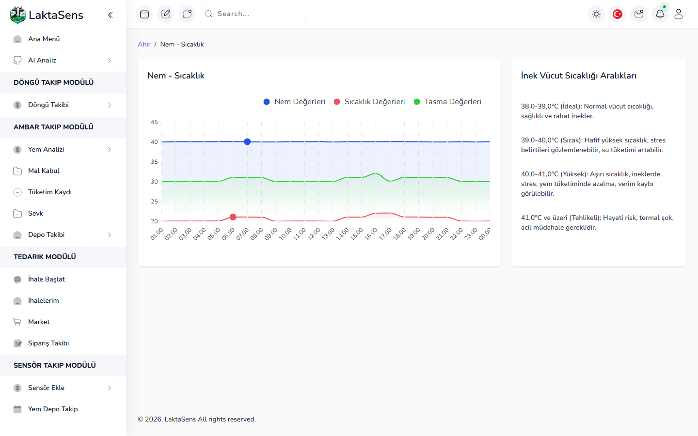
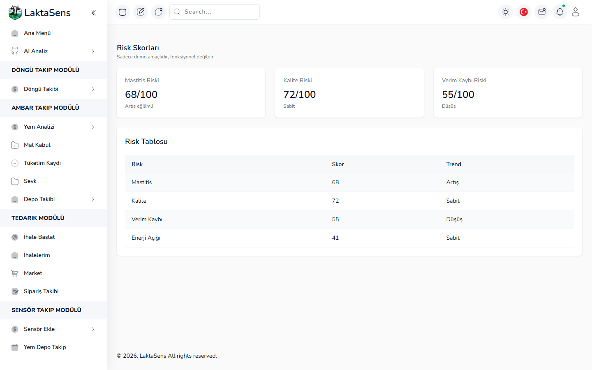
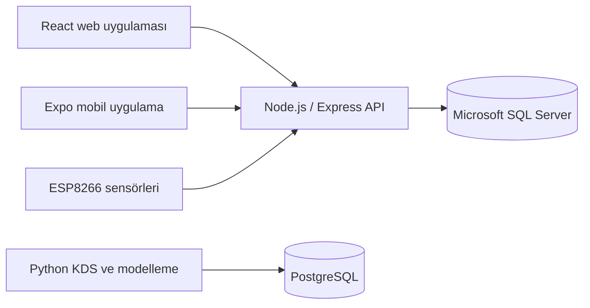

# LaktaSens

> Süt sığırcılığında sürü, sağım, yem, depo, tedarik ve sensör süreçlerini tek platformda birleştiren akıllı çiftlik yönetim sistemi.

LaktaSens; çiftçiler, yem tedarikçileri ve sistem yöneticileri için web ve mobil arayüzler sunar. Platform; hayvan yaşam döngüsü takibi, süt ölçümleri, yem stoku, ihale ve sipariş yönetimi gibi operasyonel işlevleri; sensör entegrasyonları ve karar destek sistemi (KDS) prototipleriyle aynı proje altında toplar.

> [!TIP]
> Projenin geliştirme süreci, teknik mimarisi, donanım prototipleri, 127 şekli ve deney sonuçları 65 sayfalık **[2209-A LaktaSens Sonuç Raporu](2209-a_sonuc_raporu_Laktasens.pdf)** içinde ayrıntılı olarak sunulmuştur.

> [!IMPORTANT]
> Projedeki bazı yapay zekâ modelleri ve karar destek sonuçları sentetik/proxy verilerle geliştirilmiş prototiplerdir. Klinik, ticari veya üretim ortamı kararlarında doğrulanmadan kullanılmamalıdır.

## İçindekiler

- [Temel özellikler](#temel-özellikler)
- [Proje ve sonuç raporu özeti](#proje-ve-sonuç-raporu-özeti)
- [Uygulamadan görüntüler](#uygulamadan-görüntüler)
- [Mimari](#mimari)
- [Teknoloji yığını](#teknoloji-yığını)
- [Proje yapısı](#proje-yapısı)
- [Hızlı başlangıç](#hızlı-başlangıç)
- [Mobil uygulama](#mobil-uygulama)
- [Karar destek sistemleri](#karar-destek-sistemleri)
- [Sensör yazılımları](#sensör-yazılımları)
- [API ve test](#api-ve-test)
- [Sık karşılaşılan sorunlar](#sık-karşılaşılan-sorunlar)
- [Lisans](#lisans)

## Temel özellikler

- Çiftçi, tedarikçi ve yönetici rolleri için ayrı paneller
- Sürü, gebe, servis, sağmal, kuru ve sürüden çıkarma takibi
- Süt ölçümü ve sağım iş emri yönetimi
- Yem tanımları, besin değerleri, stok ve depo hareketleri
- İhale, teklif, sipariş, sevkiyat, mal kabul ve iade akışları
- QR kod ile hayvan, sevkiyat ve sensör işlemleri
- NodeMCU/ESP8266 tabanlı ahır, tasma ve sağım sensör prototipleri
- Süt/sağlık/besleme riski, rasyon optimizasyonu ve sürüde tut/çıkar karar destek prototipleri

## Proje ve sonuç raporu özeti

| Bilgi | Açıklama |
|---|---|
| Proje | LaktaSens — Küçük Çiftçiler İçin Süt Sağım Sistemleri İyileştirme |
| Program | 2209-A Üniversite Öğrencileri Araştırma Projeleri Destek Programı |
| Proje dönemi | 24 Ekim 2024 – 2 Temmuz 2026 |
| Proje yürütücüsü | Artun KARA |
| Danışman | Seda Balta KAÇ |
| Ayrıntılı rapor | [2209-A LaktaSens Sonuç Raporu'nu aç](2209-a_sonuc_raporu_Laktasens.pdf) |

### Amaç ve ortaya çıkan sistem

Proje, küçük ve orta ölçekli süt üreticilerinin manuel yürüttüğü sağım, hayvan bazlı verim takibi, yem planlama ve operasyonel karar süreçlerini dijitalleştirmek amacıyla geliştirilmiştir. Temel hedef; veri kaybını ve yem israfını azaltmak, üretim sürecini izlenebilir hale getirmek ve çiftçiye veriye dayalı karar desteği sunmaktır.

Rapor dönemi sonunda aşağıdaki bileşenlerden oluşan bütünleşik bir prototip ortaya çıkmıştır:

- Çiftçi, tedarikçi ve yönetici rollerini destekleyen web uygulaması
- Saha işlemleri, QR tarama ve sağım akışı için Expo tabanlı mobil uygulama
- Web, mobil ve sensör istemcilerini MSSQL veritabanına bağlayan merkezi Express API
- Debimetre, LCD ve ESP8266/NodeMCU bileşenleriyle geliştirilen sağım sensörü; ahır/depo ve tasma sensör prototipleri
- Sürü takibi, süt ölçümü, yem/depo yönetimi, ihale, teklif, sipariş, sevkiyat ve kabul/iade iş akışları
- Süt-sağlık-besleme riski, rasyon skorlama ve uzun vadeli sürü kararları için araştırma amaçlı KDS altyapısı

Karar destek zinciri üç tamamlayıcı aşamada ele alınmıştır: **Faz 1** hayvan bazlı risk ve verim sinyalleri üretir; **Faz 2** bu sinyalleri yem maliyeti, beklenen süt geliri ve sağlık cezalarıyla birlikte rasyon/reward skoruna dönüştürür; **Faz 3** ise hayvanı sürüde tutma veya çıkarma kararını MDP ve pekiştirmeli öğrenme yaklaşımlarıyla inceler.

### Raporlanan prototip bulguları

| Çalışma | Raporlanan sonuç | Doğru yorum |
|---|---|---|
| Faz 1 — risk tahmini | 21.840 inek-gün kaydında 19 model karşılaştırıldı. LDA; `0,7418 ± 0,0280` CV PR-AUC ve `0,7048` test PR-AUC ile pratik aday olarak öne çıktı. | Veri sentetik/proxy ağırlıklıdır; sonuç, modelleme hattını doğrular ancak saha performansı iddiası değildir. |
| Faz 2 — rasyon/reward | 16 hayvana ait 224 simülasyon kaydında Ridge Regression `5,0335` RMSE, `3,8424` MAE ve `0,9999` R² üretti. | Yüksek uyum, kural tabanlı reward fonksiyonunun öğrenilebilir olduğunu gösteren POC sonucudur; gerçek dünya genellemesi değildir. |
| Faz 3 — keep/cull kararı | Value Iteration 162 durumun 144'ünde `keep`, 18'inde `cull` politikası üretti. Simülasyonda Q-Learning ortalama `-203,78` getiriyle MDP referansına yakın, basit kurallardan daha iyi sonuç verdi. | Sonuçlar simülatör ve varsayımsal ekonomi üzerindedir; gerçek geçmiş karar kayıtlarıyla yeniden kalibrasyon gerekir. |

Projenin mevcut en güçlü çıktısı; yalnızca ekranlardan oluşan bir yönetim paneli değil, sensörden veri alabilen, veriyi saklayıp işleyebilen ve ileride gerçek saha verileriyle doğrulanabilecek karar destek çıktılarına dönüştürebilen teknik altyapının kurulmuş olmasıdır. Deney tasarımları, metrikler, formüller, donanım bağlantıları ve tüm arayüzler için [sonuç raporunu inceleyin](2209-a_sonuc_raporu_Laktasens.pdf).

## Uygulamadan görüntüler

### Web ana sayfası

<p align="center">
  
</p>

<p align="center"><sub>Bireysel süt takibi, yem optimizasyonu ve yerel tedarik modüllerini tanıtan ortak web ana sayfası.</sub></p>

### Mobil çiftçi paneli

<p align="center">
  
</p>

<p align="center"><sub>Günlük süt üretimi, sürü durumu ve üretim liderlerini özetleyen mobil saha ekranı.</sub></p>

### Sensör ve karar destek ekranları

<table>
  <tr>
    <td width="50%"></td>
    <td width="50%"></td>
  </tr>
  <tr>
    <td align="center"><sub>Nem, sıcaklık ve tasma verilerinin web üzerinden izlenmesi.</sub></td>
    <td align="center"><sub>Risk skorları arayüzü. Bu ekran ve içindeki değerler demo amaçlıdır.</sub></td>
  </tr>
</table>

## Mimari



Ana web ve mobil uygulama `API/` altındaki Express servisini ve MSSQL veritabanını kullanır. `KDS/` altındaki araştırma/modelleme modülleri ise ayrı PostgreSQL şemalarıyla çalışır; temel uygulamayı ayağa kaldırmak için KDS kurulumu zorunlu değildir.

## Teknoloji yığını

| Katman | Teknolojiler |
|---|---|
| Web | React 18, TypeScript, Vite, Mantine, Tailwind CSS, Redux Toolkit |
| Mobil | React Native, Expo, TypeScript, React Navigation, Axios |
| API | Node.js, Express, `mssql` |
| Ana veritabanı | Microsoft SQL Server |
| KDS / makine öğrenmesi | Python, PostgreSQL, scikit-learn, XGBoost, LightGBM, CatBoost, PyTorch |
| IoT | ESP8266/NodeMCU, Arduino, DHT11 ve sağım sensör bileşenleri |

## Proje yapısı

```text
LaktaSens/
├── API/                  # Express API ve MSSQL bağlantısı
├── Database/
│   ├── mssql/            # Ana uygulama şeması ve demo verileri
│   └── postersql/        # PostgreSQL core şema çalışması
├── UI/
│   ├── LaktaSense/      # React/Vite web uygulaması
│   └── Mobile/          # Expo/React Native mobil uygulama
├── Sensor/               # ESP8266/NodeMCU Arduino kodları
├── KDS/
│   ├── LaktaRisk/       # Süt, sağlık ve besleme riski
│   ├── Smart_Feed/      # Akıllı yem ve rasyon modelleri
│   └── Sürüden_keep_cull/ # Tut/çıkar RL-MDP prototipi
├── postman/              # Postman API koleksiyonu
├── presentation/         # Proje sunumları
└── docs/                 # Ek dokümantasyon
```

## Hızlı başlangıç

### 1. Gereksinimler

Temel web uygulaması için:

- Git
- Node.js 20 LTS veya daha yeni bir LTS sürümü
- npm
- Microsoft SQL Server
- SQL Server Management Studio (SSMS) veya `sqlcmd`

Mobil uygulamayı fiziksel cihazda çalıştırmak için bunlara ek olarak Expo Go; KDS modülleri için Python 3.11+ ve PostgreSQL gerekir.

### 2. Depoyu alın

```bash
git clone https://github.com/ArtunKARA/LaktaSens.git
cd LaktaSens
```

### 3. MSSQL veritabanını hazırlayın

> [!CAUTION]
> [`Database/mssql/databaseCreate.sql`](Database/mssql/databaseCreate.sql) betiği, varsa `laktasens` veritabanını siler ve yeniden oluşturur. Mevcut veriniz varsa önce yedek alın ve betiği yalnızca doğru SQL Server örneğinde çalıştırdığınızdan emin olun.

SSMS üzerinden aşağıdaki dosyaları sırasıyla çalıştırın:

1. [`Database/mssql/databaseCreate.sql`](Database/mssql/databaseCreate.sql)
2. [`Database/mssql/cityData.sql`](Database/mssql/cityData.sql)
3. [`Database/mssql/dumyData.sql`](Database/mssql/dumyData.sql) — isteğe bağlı demo verileri

`cityData.sql` dosyasındaki ilk satır eski `laktasense` adını kullanır. Çalıştırmadan önce bu satırı `USE [laktasens]` olarak değiştirin veya sorgunun hedef veritabanını güvenli biçimde `laktasens` olarak ayarlayın.

`sqlcmd` kullanan bir Windows ortamında örnek akış:

```powershell
sqlcmd -S localhost -E -i Database\mssql\databaseCreate.sql
# cityData.sql içindeki veritabanı adını düzelttikten sonra:
sqlcmd -S localhost -E -i Database\mssql\cityData.sql
sqlcmd -S localhost -E -d laktasens -i Database\mssql\dumyData.sql
```

SQL kullanıcı adı/parola ile bağlanıyorsanız `-E` yerine kendi güvenli kimlik doğrulama yönteminizi kullanın. Parolayı komut geçmişine veya depoya yazmayın.

### 4. API ortam değişkenlerini ayarlayın

Örnek yapılandırmayı kopyalayarak `API/.env` dosyasını oluşturun:

```bash
cp API/.env.example API/.env
```

Ardından değerleri kendi ortamınıza göre düzenleyin:

```dotenv
DB_USER=<mssql-kullanici-adi>
DB_PASSWORD=<mssql-parolasi>
DB_SERVER=localhost
DB_DATABASE=laktasens
DB_PORT=1433

DB_ENCRYPT=false
DB_TRUST_SERVER_CERTIFICATE=true

MOBILE_AUTH_SECRET=<uzun-rastgele-bir-deger>
MOBILE_TOKEN_TTL_SECONDS=86400

PORT=3030
CORS_ORIGIN=http://localhost:5173
```

- Yerel SQL Server sertifikanız ve ağ yapınıza göre `DB_ENCRYPT` ile `DB_TRUST_SERVER_CERTIFICATE` değerlerini değiştirin.
- SQL Server adlandırılmış bir instance veya farklı port kullanıyorsa `DB_SERVER`/`DB_PORT` değerlerini kendi ortamınıza göre düzenleyin.
- `MOBILE_AUTH_SECRET` için tahmin edilemeyen ve her ortamda farklı bir değer kullanın. Örneğin `openssl rand -hex 32` ile üretebilirsiniz.
- `.env` dosyası gizli bilgi içerir; Git'e eklemeyin.

### 5. API'yi çalıştırın

```bash
cd API
npm ci
npm run dev
```

Başarılı başlangıçta konsolda MSSQL bağlantı mesajı ve `App started running on 3030` görünür. Ayrı bir terminalde kontrol edin:

```bash
curl http://localhost:3030/
curl http://localhost:3030/api/mobile/health
```

İlk istek `Working API` yanıtını döndürmelidir.

### 6. Web uygulamasını çalıştırın

Yeni bir terminal açın:

```bash
cd UI/LaktaSense
npm ci
npm run dev
```

Vite'ın terminalde gösterdiği adresi, varsayılan olarak [http://localhost:5173](http://localhost:5173), tarayıcıda açın. Web istemcisindeki mevcut API istekleri `http://localhost:3030` adresini kullandığı için API'nin 3030 portunda çalışması gerekir.

Demo verileri kurulduysa yerel geliştirme için örnek hesaplar:

| Rol | E-posta | Parola |
|---|---|---|
| Yönetici | `admin1@example.com` | `password123` |
| Çiftçi | `ciftci1@example.com` | `password123` |
| Tedarikçi | `tedarikci1@example.com` | `password123` |

Bu hesaplar yalnızca yerel demo veritabanı içindir. Üretim ortamında kullanmayın ve gerçek kullanıcı parolalarını düz metin olarak saklamayın.

### 7. Üretim derlemesi

```bash
cd UI/LaktaSense
npm run build
npm run preview
```

Derleme çıktısı `UI/LaktaSense/dist/` altında oluşur.

## Mobil uygulama

Mobil istemci, `API/routers/mobile.js` altındaki `/api/mobile` uç noktalarını kullanır.

```bash
cd UI/Mobile
npm ci
cp .env.example .env.local
npm run start
```

`UI/Mobile/.env.local` içinde API adresini çalıştırdığınız ortama göre ayarlayın:

```dotenv
EXPO_PUBLIC_API_URL=http://<BILGISAYARIN_LAN_IP_ADRESI>:3030
```

- Web önizleme: `npm run web`
- Android emülatörü: `http://10.0.2.2:3030`
- Fiziksel cihaz: bilgisayarın LAN IP adresi; cihaz ve bilgisayar aynı ağda olmalıdır
- iOS yerel derleme: macOS ve Xcode gerekir

Fiziksel cihaz API'ye ulaşamıyorsa güvenlik duvarında 3030 portuna yerel ağ erişimi verildiğini kontrol edin ve Expo sunucusunu ortam değişikliğinden sonra yeniden başlatın. Ayrıntılar için [`UI/Mobile/README.md`](UI/Mobile/README.md) dosyasına bakın.

## Karar destek sistemleri

KDS modülleri ana uygulamadan bağımsız kurulabilir:

| Modül | Amaç | Dokümantasyon |
|---|---|---|
| LaktaRisk / Proje A | Süt verimi, sağlık riski ve besleme ihtiyacı tahmini | [`KDS/LaktaRisk/README.md`](KDS/LaktaRisk/README.md) |
| Smart Feed / Proje B | Rasyon skoru, maliyet, reward ve politika modelleme | [`KDS/Smart_Feed/models/README.md`](KDS/Smart_Feed/models/README.md) |
| Keep/Cull RL-MDP | Hayvanı sürüde tutma veya çıkarma kararı için model tabanlı MDP/RL prototipi | [`KDS/Sürüden_keep_cull/README.md`](KDS/S%C3%BCr%C3%BCden_keep_cull/README.md) |

Tipik Python ortamı:

```bash
python -m venv .venv

# Linux / macOS
source .venv/bin/activate

# Windows PowerShell
# .\.venv\Scripts\Activate.ps1

python -m pip install --upgrade pip
```

Ardından seçtiğiniz modülün README dosyasındaki `requirements.txt`, PostgreSQL şema, veri hazırlama ve eğitim adımlarını izleyin. Smart Feed modellerinde bağlantı genellikle aşağıdaki ortam değişkeniyle verilir:

```dotenv
SMART_FEED_DATABASE_URL=postgresql+psycopg2://<kullanici>:<parola>@localhost:5432/<veritabani>
```

> [!NOTE]
> Büyük harici veri dosyalarının tamamı depoda bulunmayabilir. KDS kurulumunda ilgili alt modülün veri indirme/hazırlama talimatlarını izleyin.

## Sensör yazılımları

Arduino kodları `Sensor/` altındadır:

- `ahirDepoTakip/`: DHT11 ile sıcaklık ve nem takibi
- `tasmaTakip/`: tasma/aktivite sensör prototipi
- `sagimSensor/`: mobil API ile entegre sağım iş emri ve ölçüm akışı

Yüklemeden önce ilgili sensör klasöründeki `arduino_secrets.example.h` dosyasını
`arduino_secrets.h` adıyla kopyalayıp Wi-Fi bilgilerini bu yerel dosyaya girin.
Sensör QR kodunu ve sunucu adresini de kendi geliştirme ortamınıza göre
değiştirin. Ayrıntılı adımlar için [`Sensor/README.md`](Sensor/README.md)
dosyasına bakın. Gerçek parolaları örnek dosyalara veya Git geçmişine eklemeyin.

Sağım sensörü için `serverBase` değeri API'yi çalıştıran bilgisayarın LAN adresini göstermelidir:

```cpp
const char *serverBase = "http://<BILGISAYARIN_LAN_IP_ADRESI>:3030";
```

## API ve test

- Ana API adresi: `http://localhost:3030`
- Mobil API sağlık kontrolü: `GET /api/mobile/health`
- Mobil kimlik doğrulama: `POST /api/mobile/login`, `GET /api/mobile/me`
- Mobil dashboard: `GET /api/mobile/dashboard`
- QR tarama: `POST /api/mobile/qr/scan`
- Sağım iş emri: `/api/mobile/milking-jobs`
- Sensör iletişimi: `/api/mobile/sensor/*`

Daha geniş istek örnekleri için [`postman/LaktaSens_Tedarik_API.postman_collection.json`](postman/LaktaSens_Tedarik_API.postman_collection.json) koleksiyonunu Postman'e aktarın.

Mevcut kalite kontrolleri:

```bash
# Web derlemesi ve TypeScript kontrolü
cd UI/LaktaSense
npm run build

# Mobil TypeScript kontrolü
cd ../Mobile
npm run typecheck
```

API projesindeki `npm test` komutu henüz gerçek bir test paketi çalıştırmaz.

## Sık karşılaşılan sorunlar

### API başlarken kapanıyor

API, MSSQL bağlantısı kurulmadan dinlemeye başlamaz. `API/.env` değerlerini, SQL Server servisinin çalıştığını, TCP/IP erişimini ve portu kontrol edin.

### Web arayüzü veri getiremiyor

Mevcut web kodundaki isteklerin çoğu `http://localhost:3030` adresine sabitlenmiştir. API'nin 3030 portunda çalıştığını ve `CORS_ORIGIN` değerinin Vite adresiyle eşleştiğini kontrol edin.

### `cityData.sql` veritabanı bulunamadı hatası veriyor

Dosyadaki `USE [laktasense]` satırını `USE [laktasens]` olarak düzeltin. Ana şema ve API sorguları `laktasens` adını kullanır.

### Mobil cihaz API'ye bağlanamıyor

Fiziksel cihazda `localhost` telefonun kendisini ifade eder. `EXPO_PUBLIC_API_URL` değerinde bilgisayarın LAN IP adresini kullanın; iki cihazın aynı ağda ve 3030 portunun erişilebilir olduğundan emin olun.

### PostgreSQL modeli MSSQL verisini görmüyor

KDS ve ana uygulama farklı veritabanı katmanlarıdır. KDS için ilgili PostgreSQL şemasını ve veri yükleme adımlarını ayrıca çalıştırın.

## Güvenlik ve proje durumu

- Demo verileri ve donanım betikleri geliştirme amaçlıdır.
- Üretim kullanımından önce parola hashleme, gizli bilgi yönetimi, yetkilendirme, CORS ve ağ güvenliği sertleştirilmelidir.
- KDS metrikleri sentetik/proxy veri kısıtlarıyla birlikte yorumlanmalıdır.

## Lisans

Copyright © 2024–2026 Artun KARA ve LaktaSens katkı sağlayanları. Tüm
hakları saklıdır.

Bu depo açık kaynak değildir. LaktaSens'e ait özgün materyaller yalnızca
ticari olmayan akademik inceleme, eğitim, değerlendirme ve projeye yönelik
güvenlik testi için görüntülenebilir ve yerel olarak çalıştırılabilir.
Değiştirme, yeniden dağıtım, herkese açık yayınlama, ticari kullanım ve
üretim ortamında kullanım önceden yazılı izin gerektirir.

Ayrıntılı koşullar için [`LICENSE`](LICENSE), Vristo/Envato şablonu,
yazılım bağımlılıkları ve harici veri kaynaklarına ait istisnalar için
[`THIRD_PARTY_NOTICES.md`](THIRD_PARTY_NOTICES.md) dosyasını inceleyin.
